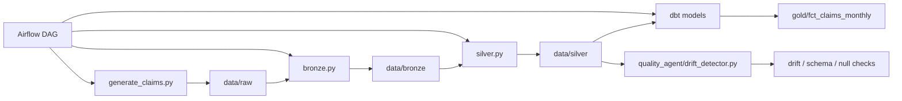

# Architecture Overview

This project models a modern lakehouse-style pipeline for insurance claims data.

## Data flow

1. Raw synthetic claims data is generated with known bad patterns.
2. Bronze stores the raw files and preserves ingestion details.
3. Silver performs type conversion, cleaning, validation, and quarantine.
4. Gold produces business-ready analytics tables using dbt.
5. A drift detector monitors schema and data changes over time.

## Why this design works

- Bronze keeps raw data untouched for traceability.
- Silver applies operational cleanup logic without breaking the pipeline.
- Gold exposes curated analytics models for reporting.
- Quality checks happen before and after transformation to reduce silent failures.
